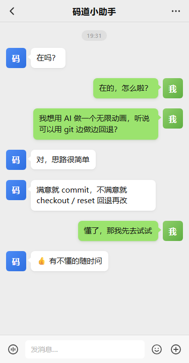

# 微信风格聊天界面

纯 HTML/CSS/JS 实现的聊天界面复刻，375×720 手机尺寸。

## 特点

- 时间分割药丸
- 气泡朝向头像的小尾巴
- 逐条弹出动画 + "对方正在输入" 动效
- 自动滚底
- `?still` 参数可关闭动画（用于截图）

## 运行

直接用浏览器打开 `index.html`。

## 开发记录

- 2026-11-22 首次推送到 GitHub
